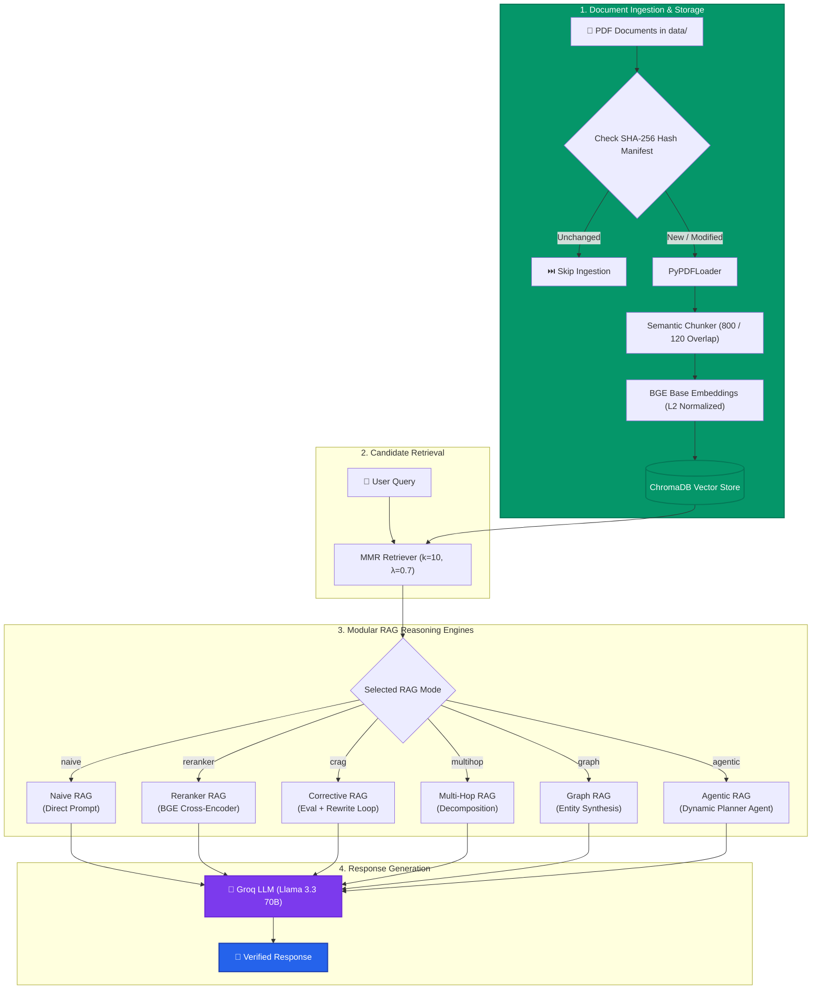

# ⚡ Modular Multi-Strategy RAG Engine

<div align="center">

[](https://www.python.org/)
[](https://www.langchain.com/)
[](https://www.trychroma.com/)
[](https://groq.com/)
[](https://huggingface.co/BAAI/bge-base-en)
[](https://opensource.org/licenses/MIT)
[](https://github.com/)

<p align="center">
  <b>A production-grade, modular Retrieval-Augmented Generation (RAG) framework implementing and benchmarking 6 cutting-edge RAG paradigms on custom PDF documents.</b>
</p>

[Key Features](#-key-features) •
[Architecture](#-architecture) •
[The 6 RAG Modes](#-the-6-rag-modes-in-depth) •
[Quickstart](#-quickstart) •
[CLI Usage](#-cli-usage) •
[Project Structure](#-project-structure) •
[Roadmap](#-roadmap)

---

</div>

## 📌 Overview

Most RAG systems fail when transitioning from simple prototypes to production because real-world queries vary widely in complexity:
- **Factoid queries** need fast single-shot retrieval.
- **Ambiguous queries** fail under standard cosine similarity and require cross-encoder reranking.
- **Poorly phrased queries** retrieve noisy documents and require self-correcting query rewrites (**CRAG**).
- **Comparative queries** need query decomposition (**Multi-Hop**).
- **Relational queries** require entity extraction and cross-entity synthesis (**Graph RAG**).
- **Exploratory research queries** need an autonomous loop that dynamically decides when it has gathered enough context (**Agentic RAG**).

This engine provides a unified, production-ready implementation of **all 6 RAG architectures**, powered by **Groq LPU™ (Llama 3.3 70B Versatile)**, **BGE Normalized Embeddings**, **ChromaDB**, and **BGE Cross-Encoder Rerankers**.

---

## ✨ Key Features

- 🧠 **6 Interchangeable RAG Architectures**: Switch seamlessly between `naive`, `reranker`, `crag`, `multihop`, `graph`, and `agentic` pipelines via a single CLI flag.
- ⚡ **Ultra-Low Latency Inference**: Powered by **Groq** serving Meta's flagship `llama-3.3-70b-versatile` model.
- 🔍 **2-Stage Retrieval Pipeline**:
  - **Stage 1**: Fast Maximal Marginal Relevance (**MMR**) retrieval (`k=10`, `fetch_k=30`, $\lambda=0.7$) balancing semantic relevance with topic diversity.
  - **Stage 2**: Precision cross-encoder reranking via `BAAI/bge-reranker-base` to eliminate semantic false-positives.
- 🔄 **Smart Incremental Ingestion**:
  - SHA-256 hash-based file manifest tracking (`db/.ingested_hashes.json`).
  - Zero redundant processing: skips unchanged PDFs on subsequent runs.
  - Chunks filtered by deterministic ID (`{source}_p{page}_c{index}`) preventing duplicate vector writes.
- ✂️ **Semantic Paragraph-Aware Chunking**: Recursive character splitting with natural paragraph/sentence boundaries (`chunk_size=800`, `overlap=120`).
- 🛡️ **Self-Healing & Quality Guardrails**:
  - In-flight document quality grading (`GOOD` vs `BAD`) with automatic query refinement loops.
  - Built-in token budget guards (`MAX_CONTEXT_CHARS = 8000`) and loop-detection guards.
- 💾 **Embedded In-Memory Embedding Cache**: MD5 hash-backed embedding vector cache to minimize inference redundant calculations.

---

## 🏗️ Architecture



---

## 🔬 The 6 RAG Modes In-Depth

| Mode | CLI Command | Mechanism | Best Used For | Latency vs Accuracy |
| :--- | :--- | :--- | :--- | :--- |
| **Naive RAG** | `python app.py naive` | Direct MMR retrieval $\rightarrow$ LLM generation. No reranking or preprocessing. | Simple lookup & benchmarking baseline. | ⚡ Ultra Fast / 🔹 Baseline |
| **Reranker RAG** | `python app.py reranker` | Bi-Encoder candidate pool (fast) + Cross-Encoder joint scoring (`BAAI/bge-reranker-base`). | Complex domain terminology & high-noise docs. | 🚀 Fast / ⭐ High Accuracy |
| **Corrective RAG (CRAG)** *(Default)* | `python app.py crag` | LLM self-evaluates context quality (`GOOD`/`BAD`). Dynamically rewrites query and retries on failure. | Ambiguous questions & vague terminology. | ⏱️ Balanced / 🌟 Very High |
| **Multi-Hop RAG** | `python app.py multihop` | Decomposes compound questions into sub-questions, executes independent retrieval, and combines. | Comparisons, multi-constraint, multi-part questions. | 🐢 Moderate / 🌟 Very High |
| **Graph RAG** | `python app.py graph` | Extracts key entities (concepts, tech), retrieves per-entity, reranks pool, synthesizes relationships. | Relationship mapping & interconnected domains. | 🐢 Moderate / 🌟 Very High |
| **Agentic RAG** | `python app.py agentic` | Autonomous agent planner inspects accumulated context and iteratively decides to continue search or `STOP`. | Exploratory research & ambiguous queries. | ⏳ Thorough / 🏆 Maximum Depth |

### 1. Naive RAG (`rag/naive.py`)
- Standard 1-shot retrieval.
- Fetches top chunks via MMR and injects directly into the prompt.
- Strict hallucination-guard prompt: instructs the model to state if sufficient context is not present.

### 2. Reranker RAG (`rag/reranker.py`)
- **Two-stage retrieval architecture**:
  1. *Bi-Encoder (MMR)*: Fast cosine similarity over embeddings to narrow corpus down to 10 candidates.
  2. *Cross-Encoder (`BAAI/bge-reranker-base`)*: Jointly attends to `(query, passage)` pairs with full cross-attention, producing calibrated relevance scores.
- Filters down to the top 3 highest-quality passages.

### 3. Corrective RAG - CRAG (`rag/crag.py`)
- Evaluates retrieved context with an LLM evaluator before answering.
- If context is deemed `BAD`, an automated query reformulator rewrites the query with synonyms/expanded terms and re-retrieves.
- Retries up to 2 times, falling back to best-effort context if threshold is unmet.

### 4. Multi-Hop RAG (`rag/multihop.py`)
- Takes questions like *"Compare the training compute of Model A and Model B"* and decomposes them into independent sub-queries:
  1. *"What is the training compute of Model A?"*
  2. *"What is the training compute of Model B?"*
- Retrieves and reranks per sub-question, deduplicates chunks, and caps combined context at 8,000 characters to prevent context window pollution.

### 5. Graph RAG (`rag/graph.py`)
- Uses LLM entity extraction to identify key concepts, named entities, and technologies from the prompt.
- Executes targeted retrieval sweeps for each entity independently.
- Pools results, applies cross-encoder reranking against the original question, and prompts the LLM for relational synthesis.

### 6. Agentic RAG (`rag/agentic.py`)
- Operates as a stateful, iterative research agent.
- In each step:
  1. Retrieves candidates using current query.
  2. Updates context memory with deduplicated reranked chunks.
  3. LLM Planner evaluates accumulated context memory against the original goal.
  4. Planner either outputs `STOP` or formulates a targeted follow-up query.
- Includes cycle detection to break infinite search loops and strict step caps (`max_steps=3`).

---

## 📂 Project Structure

```text
├── app.py                  # Main CLI entrypoint & interactive REPL loop
├── requirements.txt        # Production dependencies
├── .env.example            # Environment variables template
├── .gitignore              # Git ignore rules (secrets, venv, vector DB)
├── RAG Types.txt           # Reference taxonomy of RAG architectures
│
├── core/                   # Shared foundational pipeline infrastructure
│   ├── ingestion.py        # PDF loader with SHA-256 hash deduplication
│   ├── chunking.py         # Semantic paragraph text splitter & chunk ID tagger
│   ├── embeddings.py       # Singleton HuggingFace BGE embeddings + cache
│   ├── vector_store.py     # ChromaDB incremental persistence manager
│   ├── retriever.py        # Maximal Marginal Relevance (MMR) retriever
│   └── llm.py              # Groq ChatGroq (Llama 3.3 70B Versatile)
│
├── rag/                    # Modular RAG strategy implementations
│   ├── naive.py            # Naive / Classic baseline RAG
│   ├── reranker.py         # Two-stage cross-encoder reranking RAG
│   ├── crag.py             # Corrective RAG with self-reflection loop
│   ├── multihop.py         # Query decomposition multi-hop RAG
│   ├── graph.py            # Entity extraction & relational Graph RAG
│   └── agentic.py          # Autonomous agent planning loop
│
├── data/                   # Input PDF document directory
│   └── *.pdf               # Drop your PDFs here
│
└── db/                     # ChromaDB persistent vector storage (auto-generated)
    └── .ingested_hashes.json # Manifest tracking ingested file hashes
```

---

## 🚀 Quickstart

### 1. Prerequisites
- **Python 3.10+**
- A free **[Groq API Key](https://console.groq.com/keys)**

### 2. Clone Repository
```bash
git clone https://github.com/Shaunak422/RAG.git
cd RAG
```

### 3. Create & Activate Virtual Environment
```bash
# macOS/Linux
python3 -m venv .venv
source .venv/bin/activate

# Windows (PowerShell)
python -m venv .venv
.venv\Scripts\Activate.ps1
```

### 4. Install Dependencies
```bash
pip install -r requirements.txt
```

### 5. Configure API Key
Create a `.env` file in the project root:
```bash
cp .env.example .env
```
Open `.env` and insert your Groq API key:
```ini
GROQ_API_KEY=gsk_your_actual_groq_api_key_here
```

### 6. Add Your Documents
Drop one or more `.pdf` files into the `data/` folder:
```bash
cp /path/to/your/documents/*.pdf data/
```

### 7. Run the Application
Start the interactive Q&A session (defaults to **Corrective RAG**):
```bash
python app.py
```

---

## 💻 CLI Usage

You can launch any of the 6 RAG modes by passing the mode name as an argument:

```bash
# Corrective RAG (Default - best balance of accuracy and self-healing)
python app.py crag

# Cross-Encoder Reranker RAG (Maximum precision on technical documents)
python app.py reranker

# Multi-Hop RAG (Best for complex, multi-part, or comparative queries)
python app.py multihop

# Agentic RAG (Autonomous agent planning loop for deep exploration)
python app.py agentic

# Graph / Entity RAG (Best for mapping relationships between entities)
python app.py graph

# Naive RAG (Fast baseline)
python app.py naive
```

### Interactive Session Example

```text
🧠 RAG Mode: crag
   Available modes: naive, reranker, crag, multihop, graph, agentic

============================================================
📥 Step 1: Ingestion
============================================================
⏭️  Skipping (already ingested): research.pdf

✅ No new files — loading existing vector store
📂 Loaded existing vector store from 'db/'

🔍 Step 5: Creating retriever (MMR, k=10)
🤖 Step 6: Loading LLM
✅ LLM ready (Llama 3.3 70B via Groq)

✅ RAG chain built: crag

📚 Available PDFs in vector store: 2
  📄 research.pdf
  📄 Registration.pdf

============================================================
💬 Ready for questions! Type 'exit' to quit.
============================================================

❓ Ask question: What are the main findings in the research paper?

🔎 CRAG: 'What are the main findings in the research paper?'
📄 Attempt 1: Retrieved 10 docs
🧠 Verdict: GOOD

✅ Answer:
Based on the provided context, the primary findings indicate...
```

---

## ⚙️ Configuration & Tuning

| Setting | Location | Description | Default |
| :--- | :--- | :--- | :--- |
| **Embedding Model** | `core/embeddings.py` | HuggingFace embedding checkpoint | `BAAI/bge-base-en` |
| **Chunk Size** | `core/chunking.py` | Maximum character length per chunk | `800` |
| **Chunk Overlap** | `core/chunking.py` | Overlap between consecutive chunks | `120` (15%) |
| **Retriever Type** | `core/retriever.py` | Diversity vs Relevance algorithm | MMR (`k=10`, `λ=0.7`) |
| **Reranker Model** | `rag/reranker.py` | Cross-encoder model for scoring | `BAAI/bge-reranker-base` |
| **LLM Model** | `core/llm.py` | Groq model identifier & temperature | `llama-3.3-70b-versatile` (0.5) |
| **Token Budget** | `rag/*.py` | Safety limit to prevent prompt overflow | `8000` chars |

---

## 🔒 Security & Git Best Practices

> [!WARNING]
> Never commit your `.env` file or sensitive API keys to GitHub!

This repository includes a pre-configured [`.gitignore`](.gitignore) that automatically prevents:
- Committing `.env` (contains `GROQ_API_KEY`)
- Committing `db/` (large SQLite and binary vector files)
- Committing Python bytecode (`__pycache__/`) and virtual environments

Before publishing:
```bash
git status
# Ensure .env and db/ are NOT listed under staged files!
```

---

## 🗺️ Roadmap

- [ ] **Hybrid Search Integration**: Combine dense BGE vector search with sparse BM25 / Meilisearch indexing.
- [ ] **Evaluation Framework**: Add automated evaluation pipelines using [Ragas](https://github.com/explodinggradients/ragas) (Faithfulness, Answer Relevance, Context Recall).
- [ ] **Interactive Web UI**: Streamlit / Next.js graphical chat interface with document citation inspector.
- [ ] **Multimodal Support**: Ingest and extract tables, charts, and diagrams from PDFs.

---

## 🤝 Contributing

Contributions, issues, and feature requests are welcome!
1. Fork the Project.
2. Create your Feature Branch (`git checkout -b feature/AmazingFeature`).
3. Commit your Changes (`git commit -m 'Add some AmazingFeature'`).
4. Push to the Branch (`git push origin feature/AmazingFeature`).
5. Open a Pull Request.

---

## 📄 License

Distributed under the **MIT License**. See `LICENSE` for more information.

<div align="center">
  <sub>Built with ❤️ using LangChain, Groq, and ChromaDB. Star ⭐ this repository if you find it helpful!</sub>
</div>
